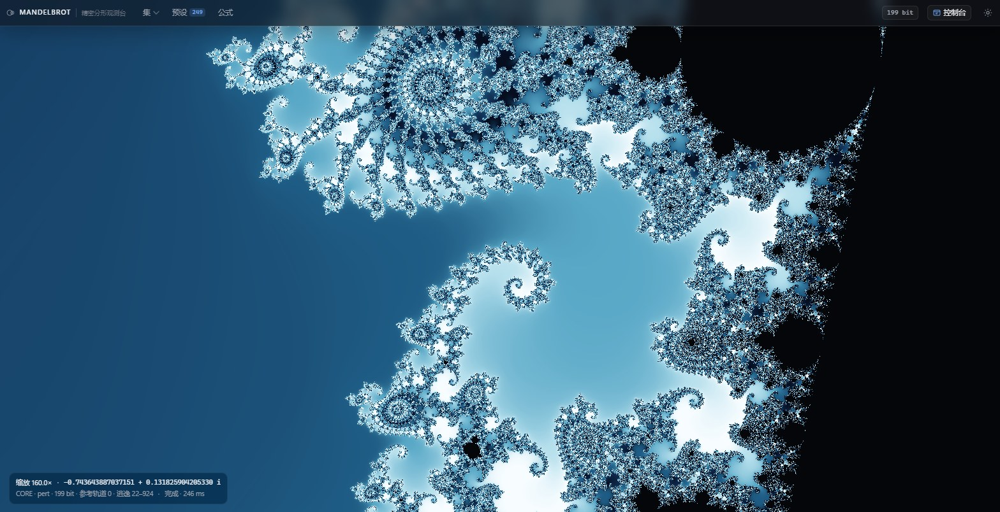

# Mandelbrot View — the desktop core, in your browser

An interactive Mandelbrot / Julia explorer whose renderer is **the desktop C++
core compiled to WebAssembly** — the same translation units that power
[Meter-Mandelbrot-Desktop](https://github.com/xiaoxu4452/Meter-Mandelbrot-Desktop):
perturbation, series approximation, periodic reference orbits, glitch repair and
a self-contained BigFloat backend.

**Open**: <https://xiaoxu4452.github.io/mandelbrot-view/> ·
**中文说明**: [README.zh.md](README.zh.md)

The interface is the explorer's own mature UI, unchanged: same toolbar, palette
panel, preset library, HUD and gestures.  What changed is underneath — the
JavaScript engine that used to iterate pixels was replaced by `core.wasm`.
Nothing in the interface is generated by the core, and nothing in the core is
reimplemented by the page.



---

## Architecture

```
page (js/app.js)            js/webcore-worker.js        core.wasm (C++ → wasm32-wasi)
 ┌──────────────┐  postMessage ┌────────────────┐  mb_render()  ┌──────────────────────┐
 │ canvas, HUD, │ ───────────▶ │ centre string, │ ────────────▶ │ deep / reference /   │
 │ palette,     │ ◀─────────── │ decimal zoom   │ ◀──────────── │ render / bigfloat /  │
 │ gestures     │  field (1 f32│ → field4       │  field4       │ viewport (desktop)   │
 └──────────────┘   per pixel) └────────────────┘               └──────────────────────┘
```

* **The page owns the picture, the core owns the mathematics.**  A frame
  request carries the centre as a decimal string at full depth (never through a
  double), the frame's complex width, the pixel size and the iteration budget.
  The core answers with the four-channel field
  `[smooth iteration, distance, iteration, 0]`, interior marked by a negative
  smooth value; the page converts that to a colour position
  (`smooth / cycle + offset`) and runs it through its own palette table, so
  colours, ramps and the re-shade cache behave exactly as before.
* **No second algorithm.**  Reference orbit election, series approximation,
  rebasing, glitch repair (including the SA replay) and the precision plan
  (`digits = log10(zoom) + 50`) are the desktop code, compiled by
  `webcore/build.mjs` from the desktop sources with an assertion shim
  (`throw` → error flag, `<thread>` stub, GMP → BigFloat stub with the
  periodic-orbit patch).  `webcore/test.mjs` compares full frames against the
  desktop `mset.exe` PNGs pixel for pixel.
* **One frame, one reference orbit — split into bands.**  A committed frame is
  one whole-view request; wasm is single-threaded here (GitHub Pages cannot send
  COOP/COEP, so there is no `SharedArrayBuffer`), so the frame is cut into
  horizontal bands and N wasm instances render them in parallel.  Every band
  shares the *frame centre's* reference orbit and the whole-frame pixel scale,
  so the bands are bit-identical to a single-band render (`?bands=N` pins the
  split, `?bands=1` forces the serial path).  A quarter-width preview lands
  first on deep views, then the full pass.
* **Views the core does not implement keep the page's own kernel**: multibrot
  powers, tricorn, burning ship, celtic, perpendicular, phoenix, Newton,
  distance shading, traps and custom formulas fall back to `js/worker.js`
  automatically — the HUD says which engine drew the frame (`CORE`, `WASM`,
  `GPU`).
* **Mobile first**: one finger pans, two fingers pinch about the moving
  midpoint, `touch-action: none` keeps the browser from hijacking the gesture,
  and the pixel budget drops to a third on a phone so a pinch stays
  interactive.

## Build and test

```bash
node webcore/build.mjs        # core sources → core.wasm (needs zig)
node webcore/test.mjs         # frames vs the desktop's own PNGs, pixel-exact
node webcore/test-view.mjs    # zoom/pan/pinch round-trip in the core's viewport
node tools/_families-check.mjs   # non-Mandelbrot families: zoom round-trip
node tools/_preset-zoom-check.mjs # preset zoom: iteration budget must stay bounded
node server/static-server.mjs # http://127.0.0.1:8777/index.html
```

The C++ core lives in this repository: `webcore/src/` holds the exact
translation units and headers the wasm build compiles, so a fresh clone can
rebuild `core.wasm` with no other checkout.  `node webcore/sync-src.mjs <path>`
refreshes that copy from the desktop project, and `MB_SRC=<path>` builds against
a desktop tree directly (which is what the author's machine does — the two
produce byte-identical `core.wasm`).

### Diagnostics

| query | what it does |
| --- | --- |
| `?diag=1` | overlay: the state, the view the last frame was painted for (`MATCH`/`STALE`), which canvas layer is on top, buffer vs canvas size, dropped-frame count |
| `?bands=N` | pin the band count (1 = serial, 6 = the pool) |
| `?scene=1` | re-enable the old 48-bit fragment iterator for A/B |
| `?engine=old` | load the previous JavaScript-only pipeline |

Deploys must bump the asset version so a CDN or a browser cannot pair new
markup with an old module: `node tools/_bump-cache.mjs <n>`, then
`node tools/_publish.mjs`.

## Layout

| path | what |
| --- | --- |
| `index.html`, `css/`, `js/` | the explorer UI (unchanged look) |
| `js/app.js` | gestures, palette, HUD, and the `corePass()` frame dispatcher |
| `js/webcore.js`, `js/webcore-worker.js` | thin ABI client for `core.wasm` |
| `core.wasm` | the desktop core, compiled |
| `webcore/src/` | **the C++ core**: bigfloat, reference orbit, deep/perturbation, render, palette, viewport |
| `webcore/build.mjs` | mirror + patch + compile pipeline (vendored sources by default) |
| `webcore/adapter.cpp` | the C ABI: `mb_render`, `mb_view_*`, `mb_render_strip`, stats POD |
| `webcore/sync-src.mjs` | refresh `webcore/src/` from a desktop checkout |
| `docs/` | screenshots used by this README |
| `tools/` | publish, cache-bump and the CDP-driven checks (`_pngdiff`, `_publish`) |

## License

MIT — see [LICENSE](LICENSE).
