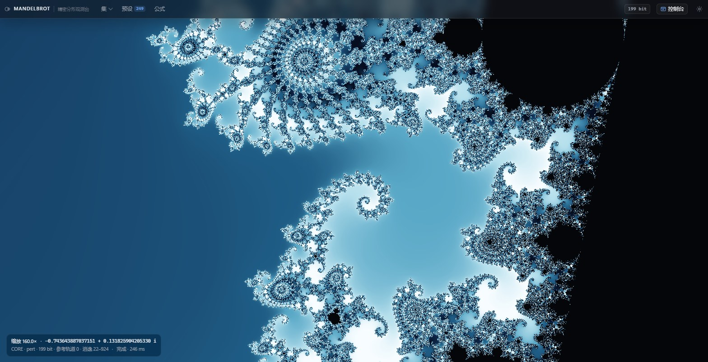

# Mandelbrot View — 桌面核心，运行在浏览器里

交互式 Mandelbrot / Julia 观测器，渲染器是**编译成 WebAssembly 的桌面 C++
核心**——与 [Meter-Mandelbrot-Desktop](https://github.com/xiaoxu4452/Meter-Mandelbrot-Desktop)
使用同一批翻译单元（扰动、级数近似、周期参考轨道、glitch 修复、自研 BigFloat
后端）。

**在线地址**：<https://xiaoxu4452.github.io/mandelbrot-view/> ·
English: [README.md](README.md)

界面用的是观测器原本那套成熟 UI，外观、工具栏、调色板、预设库、HUD、手势全部
没有改动；换掉的只是底下那颗“大脑”——原来用 JavaScript 逐像素迭代的引擎被
`core.wasm` 取代。界面不由核心生成，核心也不由页面重新实现。



---

## 结构

```
page (js/app.js)            js/webcore-worker.js        core.wasm (C++ → wasm32-wasi)
 ┌──────────────┐  postMessage ┌────────────────┐  mb_render()  ┌──────────────────────┐
 │ canvas、HUD、│ ───────────▶ │ 全精度中心字符串│ ────────────▶ │ deep / reference /   │
 │ 调色板、手势 │ ◀─────────── │ 十进制缩放、尺寸│ ◀──────────── │ render / bigfloat /  │
 │              │  场 1×f32/px │ → field4       │  field4       │ viewport（桌面原件） │
 └──────────────┘              └────────────────┘               └──────────────────────┘
```

* **画面归页面，数学归核心。** 一帧请求携带：全精度十进制中心字符串（从不经过
  double）、画面的复平面宽度、像素尺寸、迭代预算。核心回四通道场
  `[平滑迭代, 距离, 迭代数, 0]`，内部用负的平滑值标记；页面把它换算成颜色位置
  （`smooth / cycle + offset`）再查自己的调色板表——所以配色、渐变、重着色缓存
  的行为与过去完全一致。
* **没有第二套算法。** 参考轨道选举、级数近似、rebase、glitch 修复（含 SA
  重放）、精度规划（`digits = log10(zoom) + 50`）都是桌面源码，由
  `webcore/build.mjs` 从桌面原件镜像并打断言补丁（`throw` → 错误标志、
  `<thread>` 桩、GMP → BigFloat 桩 + 周期轨道补丁）后编译。`webcore/test.mjs`
  与桌面 `mset.exe` 生成的 PNG 逐像素比对。
* **一帧一条参考轨道（按横带并行）。** 成帧仍是一次整幅请求：这里的 wasm 是单线程
  （GitHub Pages 给不了 COOP/COEP，没有 `SharedArrayBuffer`），所以把整帧切成横带、
  由 N 个 wasm 实例并行渲染。每条带共用**帧中心**的参考轨道和整帧的像素尺度，结果与
  单带渲染逐字节相同（`?bands=N` 固定切法，`?bands=1` 走串行）。深视点先出 0.34×
  预览，再出整帧。
* **核心不支持的公式自动回退**到页面自己的内核：multibrot 次幂、tricorn、
  burning ship、celtic、perpendicular、phoenix、Newton、距离着色、trap、
  自定义公式。HUD 会写明这一帧是哪个引擎画的（`CORE` / `WASM` / `GPU`）。
* **为手机适配**：单指拖动平移，双指围绕移动中的中点捏合缩放，`touch-action:
  none` 阻止浏览器抢手势；手机的像素预算降到桌面的三分之一，捏合不会卡死。

## 构建与验证

```bash
node webcore/build.mjs        # 核心源码 → core.wasm（需要 zig）
node webcore/test.mjs         # 与桌面 PNG 逐像素比对
node webcore/test-view.mjs    # 核心 viewport 的缩放/平移/捏合往返
node tools/_families-check.mjs    # 非曼德勃罗族：缩放往返
node tools/_preset-zoom-check.mjs # 预设放大：迭代预算不得失控
node server/static-server.mjs # http://127.0.0.1:8777/index.html
```

**C++ 核心源码就在本仓库里**：`webcore/src/` 是 wasm 构建实际编译的那批翻译单元与
头文件，所以只 clone 本仓库就能重建 `core.wasm`，不需要别的检出。
`node webcore/sync-src.mjs <路径>` 从桌面工程刷新这份副本；`MB_SRC=<路径>` 可以
直接对桌面工作树编译（作者本机就是这么做的；两者产出的 `core.wasm` 逐字节相同）。

### 诊断开关

| 查询参数 | 作用 |
| --- | --- |
| `?diag=1` | 浮层：状态、最后落帧实际画的视点（`MATCH`/`STALE`）、当前在最上面的画布层、缓冲区与画布尺寸、丢帧计数 |
| `?bands=N` | 固定横带数量（1 = 串行，6 = 线程池） |
| `?scene=1` | 重新启用旧的 48 位片元迭代器做 A/B |
| `?engine=old` | 加载上一版纯 JavaScript 引擎 |

部署时必须升资源版本号，否则 CDN 或浏览器会把新 HTML 和旧模块配在一起：
`node tools/_bump-cache.mjs <n>`，然后 `node tools/_publish.mjs`。

## 目录

| 路径 | 内容 |
| --- | --- |
| `index.html`、`css/`、`js/` | 观测器 UI（外观未改） |
| `js/app.js` | 手势、调色板、HUD，以及 `corePass()` 派帧 |
| `js/webcore.js`、`js/webcore-worker.js` | `core.wasm` 的薄 ABI 客户端 |
| `core.wasm` | 编译后的桌面核心 |
| `webcore/src/` | **C++ 核心源码**：bigfloat、参考轨道、扰动、render、palette、viewport |
| `webcore/build.mjs` | 镜像 + 补丁 + 编译流水线（默认用仓库内源码） |
| `webcore/adapter.cpp` | C ABI：`mb_render`、`mb_view_*`、`mb_render_strip`、stats POD |
| `webcore/sync-src.mjs` | 从桌面检出刷新 `webcore/src/` |
| `docs/` | README 用的截图 |
| `tools/` | 发布、缓存版本、以及 CDP 驱动的检查脚本 |

## 许可

MIT — 见 [LICENSE](LICENSE)。
