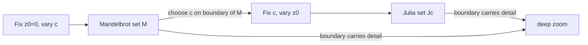
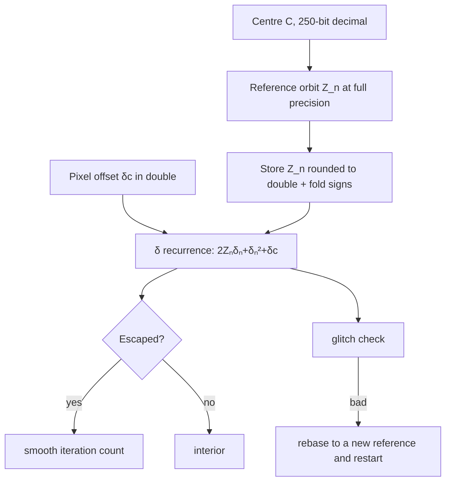

# The Mathematics Behind the Fractals

*A self-contained tutorial for the deep-zoom engine in `src/` and `src/mathx/`.*
*Read this if you want to know why a picture is correct — not just how to click.*

Chinese edition: [`FRACTAL_MATH.zh.md`](FRACTAL_MATH.zh.md)

---

## Table of contents

0. [How to read this book](#0-how-to-read-this-book)
1. [Complex numbers, from scratch](#1-complex-numbers-from-scratch)
2. [One recurrence, two planes](#2-one-recurrence-two-planes)
3. [Escape time: turning a rule into a colour](#3-escape-time-turning-a-rule-into-a-colour)
4. [Smooth colouring: getting rid of the rings](#4-smooth-colouring-getting-rid-of-the-rings)
5. [Why double precision dies at 10¹⁶](#5-why-double-precision-dies-at-1016)
6. [Perturbation: the trick that makes infinity cheap](#6-perturbation-the-trick-that-makes-infinity-cheap)
7. [The five folded families](#7-the-five-folded-families)
8. [User formulas and the analytic jet](#8-user-formulas-and-the-analytic-jet)
9. [Finding a point worth zooming into](#9-finding-a-point-worth-zooming-into)
10. [The precision stack](#10-the-precision-stack)
11. [The iteration budget and the "black blob"](#11-the-iteration-budget-and-the-black-blob)
12. [A cookbook of reproducible commands](#12-a-cookbook-of-reproducible-commands)
13. [Glossary](#13-glossary)

---

## 0. How to read this book

The engine draws one kind of object: **the boundary of the set of starting values whose orbit does not run away**.
Every feature in the program — 256-bit coordinates, a reference orbit, a jet, an iteration counter — exists to answer one question correctly and quickly:

> For this pixel, does the orbit stay bounded, and if it escapes, *when*?

The chapters go from that question to the code in increasing order of difficulty. Every formula is written out; no step is "left as an exercise".

```
     complex arithmetic  →  iteration  →  escape time  →  smooth colour
                                  ↓
                    double precision fails at 1e16
                                  ↓
        reference orbit (arbitrary precision) + perturbation (double)
                                  ↓
              folded families / user formulas / 1e120
```

---

## 1. Complex numbers, from scratch

A complex number is a pair of real numbers:

$$
z = x + iy, \qquad i^2 = -1
$$

`x` is the **real part** (`Re z`), `y` is the **imaginary part** (`Im z`). Think of it as the point `(x, y)` on a plane — the **complex plane**.

**Addition** is componentwise:

$$
(x+iy)+(u+iv) = (x+u) + i(y+v)
$$

**Multiplication** uses $i^2=-1$:

$$
(x+iy)(u+iv) = (xu-yv) + i(xv+yu)
$$

Check with a real example: $(1+2i)(3-i) = (3+2) + i(-1+6) = 5+5i$.

**Modulus** (distance from the origin):

$$
|z| = \sqrt{x^2+y^2}
$$

**Conjugate** (mirror in the real axis):

$$
\bar z = x - iy
$$

Useful identities that the shader and the jet both use:

| identity | meaning |
| --- | --- |
| $z\bar z = x^2+y^2 = \lvert z\rvert^2$ | a complex number times its conjugate is real |
| $\operatorname{Re}z = (z+\bar z)/2$ | extract the real part |
| $\operatorname{Im}z = (z-\bar z)/(2i)$ | extract the imaginary part |
| $\overline{z^2} = \bar z^{\,2}$ | conjugation commutes with squaring |
| $|uv| = |u|\,|v|$ | modulus is multiplicative |

**Squaring**, the one operation the Mandelbrot set repeats millions of times:

$$
z^2 = (x+iy)^2 = (x^2-y^2) + i(2xy)
$$

The program gives the two pieces names because they reappear in every family:

$$
A = x^2-y^2, \qquad B = 2xy, \qquad z^2 = A + iB
$$

A crucial observation for chapter 7: **all five built-in families are made by changing the signs or absolute values of `A` and `B`**. That is why they can share one exact perturbation engine.

---

## 2. One recurrence, two planes

Take a function $f$ and repeat it:

$$
z_0 \text{ given}, \qquad z_{n+1} = f(z_n, c)
$$

For the quadratic map $f(z,c)=z^2+c$ this is

$$
z_{n+1} = z_n^2 + c, \qquad z_0 = 0 \text{ (Mandelbrot) or } z_0 \text{ free (Julia)}
$$

There are **two different ways** to look at the same formula. Confusing them is the single most common source of "why is my picture wrong".

| | Mandelbrot set **M** | Julia set **J_c** |
| --- | --- | --- |
| what varies | the parameter $c$ | the starting point $z_0$ |
| what is fixed | $z_0 = 0$ | $c$ |
| plane you see | the **parameter plane** | the **dynamical plane** |
| one pixel means | "try this $c$" | "try this $z_0$" |
| definition | $\{c : z_n(c) \text{ stays bounded}\}$ | $\{z_0 : z_n(z_0) \text{ stays bounded}\}$ |

Formally:

$$
M = \{\,c\in\mathbb{C} : \sup_n |z_n| < \infty,\ z_0=0,\ z_{n+1}=z_n^2+c\,\}
$$

$$
K_c = \{\,z_0\in\mathbb{C} : \sup_n |z_n| < \infty\,\}, \qquad J_c = \partial K_c
$$

The Julia set $J_c$ is the **boundary** of the filled Julia set. If $c\in M$, $J_c$ is connected; if $c\notin M$, it is a Cantor dust. This is the fundamental link between the two pictures.



**Why the boundary?** Inside the set nothing much happens (all orbits go to the same attractor); outside, everything escapes at similar speeds. The *interesting* variation — filaments, spirals, self-similarity — lives on the separating curve. That is also why deep zooms must be centred on a boundary point: chapter 9 generates such points to 220 digits.

---

## 3. Escape time: turning a rule into a colour

For a pixel, iterate until either

1. $|z_n| > R$ (escaped), or
2. $n = N$ (budget exhausted).

The escaped pixel gets the **escape time** $n$. The others are *interior* and are painted black.

**Why is $R=2$ enough?** Suppose $|c|\le 2$ and $|z_n|>2$. Then

$$
|z_{n+1}| = |z_n^2+c| \ge |z_n|^2 - |c| > |z_n|^2-2
$$

For $|z_n|>2$ we have $|z_n|^2-2 > |z_n|$, hence $|z_{n+1}|>|z_n|$ and the modulus grows at least quadratically. Once beyond 2, escape is certain. (Points with $|c|>2$ escape on the first step, so the test is complete.)

```text
n = 0        z0 = 0
n = 1        z1 = c                  |z1| <= 2 ? continue
n = 2        z2 = c^2 + c
...
n = 800      z800                    |z| never exceeded 2 -> INTERIOR
```

The iteration count is not just a colour index. It is a **distance-like coordinate**: near the boundary it changes rapidly from pixel to pixel, which is exactly what makes the filigree visible. If $N$ is too small, every pixel is cut off at $N$ and the whole frame becomes black — see chapter 11.

**Interior shortcuts.** Two regions of the Mandelbrot set can be decided without iterating:

$$
\text{cardioid: } q=\left(x-\tfrac14\right)^2+y^2,\qquad
q\left(q+\left(x-\tfrac14\right)\right)\le \tfrac14 y^2
$$

$$
\text{period-2 bulb: } (x+1)^2+y^2\le \tfrac1{16}
$$

The program also detects a repeating orbit (period $p$) by comparing $z_n$ with earlier values; a periodic orbit never escapes.

---

## 4. Smooth colouring: getting rid of the rings

Integer escape times produce visible contour rings. To interpolate, use the fact that after escaping the orbit grows like $z_{n+1}\approx z_n^2$, so $\log|z_n|$ doubles each step. Define

$$
\nu = n + 1 - \log_2\!\left(\frac{\ln |z_n|}{\ln 2}\right)
$$

**Derivation in four lines.** Near escape write $|z_n| \approx R^{2^{\,n-s}}$ for a real-valued "escape time" $s$. Taking logs twice:

$$
\ln|z_n| \approx 2^{\,n-s}\ln R
\;\Longrightarrow\;
\log_2\frac{\ln|z_n|}{\ln R} \approx n-s
\;\Longrightarrow\;
s \approx n-\log_2\frac{\ln|z_n|}{\ln R}
$$

With $R=2$ and an index shift this is the formula above. $\nu$ varies continuously across pixel boundaries, so the colour ramp is smooth. The program stores this **smooth field** (one float per pixel) and re-shades it from the palette without re-iterating — that is why dragging a colour slider is instant.

The colour stage then applies, in order: saturation → contrast → gamma ($c^{1/\gamma}$) → gain → brightness. Palette frequencies and phases are applied in the **logarithmic** iteration domain, not in RGB space.

---

## 5. Why double precision dies at 10¹⁶

An IEEE-754 double has 53 significant bits ≈ 15.95 decimal digits. At a viewing width $W$ and magnification $10^d$, the plane distance per pixel is roughly

$$
p \approx \frac{3}{W\,10^d}
$$

To distinguish neighbouring pixels you need the centre coordinate to carry at least

$$
\text{digits} \gtrsim d + \log_{10} W + \text{guard}
$$

decimal places. Examples:

| zoom | needed digits for a 1000 px frame |
| --- | --- |
| $10^{7}$ | ≈ 11 |
| $10^{16}$ | ≈ 20 (double is out of digits) |
| $10^{26}$ | ≈ 30 |
| $10^{120}$ | ≈ 124 |

The program therefore chooses `digits = zoom_depth + 50` (rounded to machine limbs) and reports it in the HUD as `bits ≈ digits × 3.321928`. The screenshot `CORE · julia · 256 bit` means about 77 decimal digits — ample for $10^{26}$.

**Two different quantities must not be confused:**

- **coordinate precision** — how many digits of the centre/pixel offset are kept (chapters 5, 10);
- **iteration budget** — how many steps the orbit may run (chapter 11).

A black frame can be caused by either. The HUD tells them apart: `参考轨道` (reference length) and `逃逸` (escape range) are iteration evidence; `bit` is coordinate evidence.

---

## 6. Perturbation: the trick that makes infinity cheap

Full-precision arithmetic for every pixel is hopeless (a 1.5 Mpx frame × 20 000 steps × 250-bit multiplication). Perturbation computes **one** full-precision orbit and millions of cheap double orbits around it.

Write every pixel as a small deviation from a reference point $C$:

$$
c = C + \delta c, \qquad z_n = Z_n + \delta_n
$$

where the reference orbit is computed at full precision:

$$
Z_0 \text{ given},\qquad Z_{n+1} = Z_n^2 + C
$$

Subtract the two recurrences:

$$
\begin{aligned}
z_{n+1} &= (Z_n+\delta_n)^2 + (C+\delta c)
        = Z_n^2 + C + 2Z_n\delta_n + \delta_n^2 + \delta c \\
\delta_{n+1} &= 2Z_n\delta_n + \delta_n^2 + \delta c
\end{aligned}
$$

The big term $Z_n^2+C$ cancels. What remains is computed in double: $Z_n$ is rounded to double, $\delta_n$ is a small double, and $\delta c$ is the pixel offset (also a double). For a **Julia** view the parameter is fixed, so $\delta c=0$ and only the initial deviation matters:

$$
\delta_0 = z_0-Z_0,\qquad \delta_{n+1}=2Z_n\delta_n+\delta_n^2
$$



### 6.1 Glitches and rebasing

The approximation fails where $Z_n+\delta_n$ is much smaller than either term — catastrophic cancellation. The test used in the core is

$$
|Z_n+\delta_n| \ll \max(|Z_n|,|\delta_n|)
$$

(implemented with squared comparisons, losing about 20 bits). When it fires, the pixel is **rebased**: a new reference is chosen nearer to that pixel and the iteration restarts from that point. The program uses up to four reference ladders and keeps the longest-living orbit.

### 6.2 Series approximation

While $\delta_n$ is tiny, the first steps are almost linear and can be skipped:

$$
\delta_n \approx A_n\,\delta c + B_n\,(\delta c)^2
$$

with coefficients propagated alongside the reference orbit. A whole block of 64 steps is then replaced by one evaluation. The program disables this below $2^{-32}$ pixel scale, where the linear model caused smooth dark arcs across the frame.

### 6.3 The reference must outlive the pixels

If the reference orbit stops at step $k$ (it escaped), then for $n>k$ there is no $Z_n$. The core therefore gives the reference the **full iteration budget** in one step (`ref_cap = maxiter`), never a short 8192 prefix. A truncated reference paints the whole frame interior — the other classic "black block" bug.

---

## 7. The five folded families

All five maps are "square, then fold some component", plus $c$. Using $A=x^2-y^2$ and $B=2xy$:

| family | map $F(x+iy)$ | folded pair $(A',B')$ |
| --- | --- | --- |
| Mandelbrot | $(x+iy)^2+c$ | $(A,\,B)$ |
| Tricorn (conjugate) | $\overline{(x+iy)}^{\,2}+c$ | $(A,\,-B)$ |
| Burning ship | $(\lvert x\rvert+i\lvert y\rvert)^2+c$ | $(A,\,2\lvert xy\rvert)$ |
| Celtic | $\lvert x^2-y^2\rvert+i\,2xy+c$ | $(\lvert A\rvert,\,B)$ |
| Perpendicular | $x^2-y^2+i\lvert 2xy\rvert+c$ | $(A,\,\lvert B\rvert)$ |
| Phoenix | $z^2+p\,z_{n-1}+c$ | $(A+p\,\Re z_{n-1},\,B+p\,\Im z_{n-1})$ |

**Why these can be exact.** The fold is a sign or absolute value; once the reference orbit tells us which branch it is on, the perturbation is still a polynomial:

$$
\delta_{n+1} = F(Z_n+\delta_n,c+\delta c)-F(Z_n,C)
$$

For example, tricorn:

$$
\delta_{n+1}=2\overline{Z_n}\,\overline{\delta_n}+\overline{\delta_n}^{\,2}+\delta c
$$

Burning ship, when reference and pixel agree on the signs of $x$ and $y$:

$$
\delta_{n+1}=2\,|X_n|\,\delta X + 2\,|Y_n|\,\delta Y + \delta X^2-\delta Y^2
  \;+\; i\bigl(2\,\mathrm{sgn}(X_nY_n)(X_n\delta Y+Y_n\delta X)+2\delta X\delta Y+\delta c_y\bigr)
$$

The sign comes **from the reference** — that is the entire trick. No Taylor remainder is thrown away, so a $10^{120}$ frame is as exact as a $10^{2}$ frame. The measured worst relative error of the recurrence against direct evaluation is $6.2\times10^{-16}$ (double epsilon).

**Phoenix has memory**: the recurrence needs $z_{n-1}$. The perturbation must store $\delta_{n-1}$ directly; reconstructing it from a huge $Z_{n-1}$ destroys the small part. This bug once shifted a whole frame by six iterations.

**Real axis fact.** For real $c$ and real $z$, all five families reduce to $z_{n+1}=z_n^2+c$. The single 220-digit Misiurewicz point

```
-1.543689012692076361570855971801747986525203297650983935240804037831...
```

(preperiod 3, period 1) is therefore a boundary point for *all four folded maps at once*, which is how the 1e120 oracle tests were made.

---

## 8. User formulas and the analytic jet

A typed formula such as `sin(z)^2 + c` is parsed by `src/mathx/expr.cpp`: lexer → Pratt parser → postfix VM. It supports $z,c,n,z_1$, single-letter parameters, implicit multiplication (`2z`, `3(z+1)`), `sum`/`prod`, comparisons and a large function table.

### 8.1 Wirtinger derivatives

A non-holomorphic function (one using `conj`, `re`, `im`, `abs`, `arg`) does not have a single complex derivative. Use the **Wirtinger operators**:

$$
\frac{\partial}{\partial z}=\frac12\left(\frac{\partial}{\partial x}-i\frac{\partial}{\partial y}\right),
\qquad
\frac{\partial}{\partial \bar z}=\frac12\left(\frac{\partial}{\partial x}+i\frac{\partial}{\partial y}\right)
$$

For a holomorphic function $F_{\bar z}=0$. The parser tracks a `holomorphic` flag and skips the conjugate terms when true; that is both faster and exact.

### 8.2 The jet

At each reference point the engine evaluates **one** object containing the value and its derivatives up to second order:

$$
\mathcal J F = \bigl(F,\;F_z,\;F_{\bar z},\;F_c,\;F_{zz},\;F_{z\bar z},\;F_{\bar z\bar z},\;F_{zc},\;F_{cc},\;F_{z_1}\bigr)
$$

Second derivatives are stored with the factor $1/2$ folded in (e.g. the stored `dzz` is $F_{zz}/2$). Seeds are $F_z[z]=1$, $F_c[c]=1$, $F_{z_1}[z_1]=1$; the chain rule propagates the tuple through every operator. This replaces five finite-difference evaluations per orbit step with one exact evaluation.

### 8.3 The pixel recurrence

With $u=\delta z$, $\Delta c=\delta c$, $p$ the pixel scale and $u_{-1}$ the previous deviation, one step is

$$
\begin{aligned}
u_{n+1} ={}& F_z\,u_n + F_{\bar z}\,\bar u_n + F_c\,\Delta c + F_{z_1}\,u_{n-1} \\
&+ p\Bigl(F_{zz}u_n^2 + F_{z\bar z}\,u_n\bar u_n + F_{\bar z\bar z}\bar u_n^2
             + F_{zc}\,u_n\Delta c + F_{cc}\,\Delta c^2\Bigr)
\end{aligned}
$$

(with the stored $1/2$ factors restored where appropriate). Terms a generically holomorphic map does not need are zero and cost nothing.

Worked example — $F(z,c)=z^2+c$:

$$
F_z=2Z,\quad F_c=1,\quad F_{zz}=2,\quad F_{\bar z}=F_{zc}=F_{cc}=0
$$

so the recurrence collapses to $u_{n+1}=2Z_nu_n+\Delta c+p\,u_n^2$, the classical perturbation formula.

Worked example — $F(z,c)=\sin(z)c+z^2$:

$$
F_z=c\cos Z+2Z,\quad F_c=\sin Z,\quad F_{zz}=-c\sin Z+2,\quad F_{zc}=\cos Z,\quad F_{cc}=0
$$

Dropping $F_{zc}$ makes most pixels land on the wrong side of the boundary; that cross term was added after a pixel-level oracle test caught it.

### 8.4 Parameter precision

A slider value rounded to a double carries only 16 digits and caps the useful depth at about $10^{16}$. `--param a=...` and `--phoenix ...` therefore take **decimal strings**, parsed as `BigFloat` at the same precision as the orbit. The test with $a=0.1+10^{-120}$ proves all 120 digits reach the kernel.

---

## 9. Finding a point worth zooming into

At $10^{120}$ almost every coordinate lands in a flat region. You need a point **on the boundary** with the same number of digits. Two solvers produce them.

**Nucleus** (period $p$): a superattracting cycle with $z_0=0$, so $z_p(c)=0$. Solve by Newton in $\mathbb C$.

**Misiurewicz point** (preperiod $m$, period $p$): a repelling, preperiodic point on the boundary, defined by

$$
F(c) = z_{m+p}(c)-z_m(c)=0
$$

Newton's method in two real variables needs the Jacobian

$$
J=\begin{pmatrix}
\partial F_r/\partial c_r & \partial F_r/\partial c_i\\
\partial F_i/\partial c_r & \partial F_i/\partial c_i
\end{pmatrix},
\qquad
\binom{c_r}{c_i}\leftarrow\binom{c_r}{c_i}-J^{-1}\binom{F_r}{F_i}
$$

with central differences of **$F$ itself**. Differentiating $z_n$ alone (and forgetting that $z_m$ also moves with $c$) makes every Newton step about 1.5× too long and converges linearly — a subtle bug found by printing the residuals.

```bash
mset misiurewicz --m 2 --p 2 --digits 300        # c = i exactly
mset nucleus --center-re -0.743643887037151 \
             --center-im 0.13182590420533 --digits 120
mset family-point --kind tricorn --preperiod 3 --period 1 \
                  --digits 220 --guess-re -1.5437
```

The last command produced the 220-digit real point quoted in chapter 7.

---

## 10. The precision stack

| layer | what it does | why |
| --- | --- | --- |
| `BigFloat` (`bigfloat.cpp`) | base-$10^9$ limbs, arbitrary length, own `add/mul` | portable, no external dependency; decimal digits map cleanly to limb counts |
| GMP bridge (`gmp_bridge.cpp`) | `dlopen("libgmp.so.10")` / `LoadLibrary`, mpf reference orbit | fast big multiplication; falls back to `BigFloat` if the DLL is absent |
| `src/mathx/bigmath.cpp` | `div`, `sqrt`, `exp`, `log`, `sin`, `cos`, `atan`, `pow`, $\pi$, $\ln 10$ at the same precision | needed by arbitrary user formulas and boundary solvers |
| `floatexp` | mantissa + binary exponent | keeps values that overflow double (deep escape counts) representable |

`digits = zoom_depth + 50` is the working width; `precision_limbs = align64(digits / 9)`. **The host must set the precision before parsing the centre**: `from_string` truncates according to a thread-local width, and a stale 90-bit setting silently cuts a 180-digit coordinate.

Measured step costs (GMP): 22 / 43 / 106 / 463 / 980 µs at 6000 / 12000 / 24000 / 60000 / 120000 bits — no FFT threshold jump in this range, so the performance lever is *fewer steps*, not a different multiplication algorithm. A periodic reference (e.g. $c=i$) is tiled analytically: $10^{60000}$ renders in 0.65 s.

---

## 11. The iteration budget and the "black blob"

This is the chapter that explains the screenshot behind the recent bug report. The HUD read:

```text
缩放 10^26.6   CORE · julia · 256 bit · 参考轨道 801 · 逃逸 780–800 · 完成 160 ms
缩放 10^26.7   CORE · julia · 256 bit · 参考轨道 961 · 逃逸 783–1146 · 完成 107 ms
```

Both frames came from **the same C++ core at the same precision**. The difference is the iteration ceiling:

| | first frame | second frame |
| --- | --- | --- |
| budget | 800 | about 1200 |
| largest escape | 800 (exactly at the ceiling) | 1146 (headroom) |
| picture | large black blob | full detail |

When the largest observed escape equals the budget, the frame is **truncated**: pixels that might have escaped later were cut off and reported as interior. The engine reacts in three steps:

1. `noteFrameObservation(cap, escMax, bounded, refLen)` records the observation.
2. If a deep frame is mostly interior and its escapes all stop at the ceiling, it is marked *suspect* and **not painted** — the previous exact frame stays on the canvas.
3. The ceiling is raised once (`observedIter.cap`, `maxRefine = 3`) and `scheduleRender(140)` renders again with the new budget.

The guard "one repaint per view" matters: at a chaotic boundary *some* pixel always reaches any finite ceiling, and an unbounded retry loop would turn a 0.25 s frame into 7 s without changing the picture.

The web and desktop builds now share this rule. Before the fix, the web build raised the ceiling but forgot step 3, so the black frame remained until the user moved the view — which is exactly why it looked like "one low-precision renderer and one correct renderer taking turns".

---

## 12. A cookbook of reproducible commands

```bash
# 1. A whole Mandelbrot set, 1200x800, 4000 iterations
mset render --center-re -0.6 --center-im 0 --zoom 1e0 \
            --width 1200 --height 800 --maxiter 4000 --out whole.png

# 2. The classic seahorse valley at 1e12 (the centre has 15 digits)
mset render --center-re -0.743643887037151 --center-im 0.13182590420533 \
            --zoom 1e12 --width 1200 --height 800 --maxiter 4000 --out seahorse.png

# 3. c = i is a Misiurewicz point: arbitrary depth, exact self-similarity
mset render --center-re 0 --center-im 1 --zoom 1e6000 --out ci.png

# 4. A folded family at 1e120 (220-digit centre from family-point)
mset family --kind tricorn --center-re <220 digits> --center-im 0 \
            --zoom 1e120 --width 800 --height 500 --maxiter 2500 --out tricorn.png

# 5. A typed formula; the parameter keeps all of its digits
mset family --kind formula --expr "z^2 + a*z + c" \
            --param a=0.1000...0001 --zoom 1e60 --out formula.png

# 6. Oracle tests (elementary functions, jets, five families, 1e60/1e120)
tests\expr.bat
tests\family.bat
```

Reading the HUD:

- `CORE / NATIVE` — the C++ kernel produced the pixels;
- `julia / pert` — Julia (fixed $c$, varied $z_0$) or Mandelbrot perturbation (varied $c$);
- `256 bit` — coordinate precision, about 77 decimal digits;
- `参考轨道 961` — reference orbit length; if it is far below the budget, suspect a short reference;
- `逃逸 783–1146` — smallest/largest observed escape count; an upper endpoint equal to the budget means "truncated".

---

## 13. Glossary

| term | meaning |
| --- | --- |
| orbit | the sequence $z_0,z_1,z_2,\dots$ |
| filled set | points whose orbit stays bounded |
| Julia set | boundary of the filled set for a fixed $c$ |
| Mandelbrot set | set of $c$ for which the orbit of $0$ stays bounded |
| escape time | first $n$ with $|z_n|>2$ |
| smooth iteration | continuous version of $n$ used for colour |
| perturbation | computing a pixel as a small deviation from a reference orbit |
| reference orbit | one full-precision orbit shared by a whole frame |
| glitch | pixel where cancellation destroys the perturbation approximation |
| rebase | restarting a glitched pixel from a nearer reference |
| series approximation | skipping early steps with a polynomial in $\delta c$ |
| fold | sign change or absolute value in a non-holomorphic family |
| jet | value plus derivatives up to a chosen order |
| Wirtinger derivative | derivative with respect to $z$ or $\bar z$ treating them as independent |
| nucleus | parameter whose critical orbit is periodic, $z_p(c)=0$ |
| Misiurewicz point | boundary parameter with $z_{m+p}(c)=z_m(c)$ |
| limb | fixed-width chunk of a big integer; here $10^9$ per limb |
| pixel scale | plane distance per pixel, $p$ |
| truncation | frame whose largest escape equals the iteration budget |

---

## Appendix A: Worked examples, step by step

The main text states the rules. This appendix applies them to small numbers you
can check with a pocket calculator. Every example is chosen so that the whole
computation fits on one page.

### Example A1 — Squaring a complex number by hand

**Question.** Compute $(1+2i)^2$.

**Step 1** — identify $x=1$, $y=2$.

**Step 2** — apply $A=x^2-y^2$:

$$A = 1^2-2^2 = 1-4 = -3$$

**Step 3** — apply $B=2xy$:

$$B = 2\cdot1\cdot2 = 4$$

**Answer.** $(1+2i)^2 = -3+4i$.

**Check by FOIL** (first, outer, inner, last):

$$(1+2i)(1+2i)=1+2i+2i+4i^2=1+4i-4=-3+4i\quad\checkmark$$

This is literally the first line of the pixel kernel: `A = x*x - y*y`,
`B = 2*x*y`.

---

### Example A2 — An orbit that never escapes: $c=-1$

Take $z_0=0$ and iterate $z_{n+1}=z_n^2-1$.

| $n$ | calculation | $z_n$ | $\lvert z_n\rvert$ |
| --- | --- | --- | --- |
| 0 | given | $0$ | 0 |
| 1 | $0^2-1$ | $-1$ | 1 |
| 2 | $(-1)^2-1$ | $0$ | 0 |
| 3 | $0^2-1$ | $-1$ | 1 |

The orbit alternates $0,-1,0,-1,\dots$ forever. The modulus never exceeds 2, so
this pixel is **interior**. The period is $p=2$; the program would detect it by
comparing $z_2$ with $z_0$ and stop early.

---

### Example A3 — An orbit that escapes, and its smooth value: $c=1$

| $n$ | calculation | $z_n$ | $\lvert z_n\rvert^2$ |
| --- | --- | --- | --- |
| 0 | given | $0$ | 0 |
| 1 | $0^2+1$ | $1$ | 1 |
| 2 | $1^2+1$ | $2$ | 4 |
| 3 | $2^2+1$ | $5$ | 25 |

The test is strict ($|z|>2$, i.e. $|z|^2>4$). At $n=2$ we have exactly 4, so the
orbit does **not** escape yet. At $n=3$, $25>4$: the integer escape time is
$n=3$.

Smooth value with $R=2$:

$$\nu = 3+1-\log_2\!\frac{\ln 5}{\ln 2}
     = 4-\log_2(2.3219)
     = 4-1.2153 = 2.7847$$

A pixel that escaped at exactly step 3 with $|z_3|$ barely above 2 would get
$\nu\approx3.0$; this one overshot far, so $\nu<3$ and its colour sits earlier
in the ramp. That continuous offset is what removes the rings.

---

### Example A4 — How many digits does a 1e26 view need?

**Given.** Viewing window $W=1920$ px, magnification $10^{26}$.

**Step 1** — pixel scale:

$$p=\frac{3}{1920\cdot10^{26}}=1.5625\times10^{-29}$$

**Step 2** — a double carries about 16 decimal digits. At a centre of order 1
its absolute rounding error is about $10^{-16}$. Compare with the pixel:

$$\frac{10^{-16}}{1.56\times10^{-29}}\approx6.4\times10^{12}$$

so a double cannot tell neighbouring pixels apart — by **twelve orders of
magnitude**. This is why the picture is flat, not because the iteration is
wrong.

**Step 3** — required digits (with 6 guard digits):

$$d+\log_{10}W+6 = 26+3.283+6 \approx 35.3 \Rightarrow 36\text{ digits}$$

**Step 4** — the program uses $26+50=76$ digits $\approx252$ bit, which is why
the HUD reads `256 bit`. The margin covers error growth along the orbit.

---

### Example A5 — One perturbation step, numerically

Take the reference parameter $C=0.25$, reference orbit $Z_0=0$, $Z_1=0.25$,
$Z_2=0.3125$. A pixel has $c=C+\delta c$ with $\delta c=10^{-10}$.

**Reference:** $Z_{n+1}=Z_n^2+C$.

**Pixel (direct):** $z_0=0$, $z_1=0.2500000001$, and

$$z_2=z_1^2+c=(0.2500000001)^2+0.2500000001=0.31250000015$$

**Perturbation:** $\delta_0=0$, $\delta_1=\delta c=10^{-10}$, then

$$\delta_2=2Z_1\delta_1+\delta_1^2+\delta c
=2(0.25)(10^{-10})+10^{-20}+10^{-10}=1.5\times10^{-10}+10^{-20}$$

**Compare:** $z_2-Z_2=0.31250000015-0.3125=1.5\times10^{-10}$ (the $10^{-20}$
term is below the printed digits). Both agree.

**What was saved?** The pixel never multiplied a 76-digit number; it multiplied
a double $Z_1$ by a double $\delta_1$. That is the whole reason 1e120 is
affordable.

---

### Example A6 — The tricorn delta is exact, not an approximation

Let $Z=0.5+0.2i$ and $\delta=0.01-0.01i$. The tricorn map is $F(z)=\bar z^{\,2}$.

**Step 1** — conjugates:

$$\bar Z=0.5-0.2i,\qquad \bar\delta=0.01+0.01i$$

**Step 2** — linear term $2\bar Z\bar\delta$:

$$(0.5-0.2i)(0.01+0.01i)=0.005+0.005i-0.002i+0.002=0.007+0.003i$$

times 2 gives $0.014+0.006i$.

**Step 3** — quadratic term:

$$\bar\delta^{\,2}=(0.01+0.01i)^2=0.0001+0.0002i-0.0001=0.0002i$$

**Step 4** — sum:

$$F(Z+\delta)-F(Z)=0.014+0.0062i$$

There is no remainder term: the map is a polynomial in $(z,\bar z)$, so the two
terms are *all* the terms. A Taylor truncation would be an approximation here;
the core's formula is exact.

---

### Example A7 — A jet for $\sin(z)c+z^2$ at a numeric point

Take $Z=0.5$, $c=1$, $u=10^{-6}$, $\Delta c=2\times10^{-6}$, $p=1$.

**Step 1** — evaluate the derivatives from the table in chapter 8:

$$F_z=c\cos Z+2Z=0.877583+1=1.877583$$
$$F_c=\sin Z=0.479426$$
$$F_{zz}=-c\sin Z+2=1.520574,\qquad F_{zc}=\cos Z=0.877583$$

**Step 2** — first-order contributions:

$$F_zu=1.877583\times10^{-6},\qquad F_c\Delta c=0.958851\times10^{-6}$$

**Step 3** — second-order contributions:

$$F_{zz}u^2=1.52\times10^{-12},\qquad F_{zc}u\Delta c=1.755\times10^{-12}$$

**Step 4** — add:

$$u'\approx2.836434\times10^{-6}$$

(The second-order terms are a millionth of the first here, but at 1e30 zoom
the pixel scale is small enough that they dominate; dropping $F_{zc}$ was a
real bug.)

---

### Example A8 — Newton finds a Misiurewicz point: $m=2,p=2$

Claim: $c=i$ is a root of $F(c)=z_4(c)-z_2(c)$.

**Step 1** — iterate exactly:

$$z_0=0,\quad z_1=i,\quad z_2=i^2+i=-1+i$$
$$z_3=(-1+i)^2+i=(1-2i-1)+i=-i,\quad z_4=(-i)^2+i=-1+i$$

**Step 2** — residue:

$$F(i)=z_4-z_2=(-1+i)-(-1+i)=0$$

exactly. No Newton step is needed. Because the orbit repeats from $z_2$ with
period 2, the reference can be tiled after the first 64 steps — that is the
0.65 s result at $10^{60000}$.

**Step 3** — why 220 digits matter: zooming to $10^{120}$ around this point
requires about 124 correct digits of $c$. The solver prints 220, so even the
last pixel at that depth has a well-defined coordinate.

---

### Example A9 — Reading a truncated frame from the HUD

Two frames of the same view reported:

```text
CORE · julia · 256 bit · ref 801 · esc 780-800
CORE · julia · 256 bit · ref 961 · esc 783-1146
```

**Step 1** — compare the escape upper end with the budget. The first frame's
upper end (800) equals its budget (also 800): pixels were cut off. The second
ends at 1146 with a budget around 1200: there is headroom.

**Step 2** — check the precision. Both report 256 bit, so the coordinate was
never the problem.

**Step 3** — conclusion: the first picture is *the same engine with a smaller
iteration ceiling*. The fix raises the ceiling and repaints before showing the
truncated image, which is why you now see one correct frame instead of a black
one followed by a correct one.

---

### Example A10 — Why a nucleus is a bad zoom target

Let $c=0$, the centre of the period-1 hyperbolic component. Then $z_0=0$ and
$z_{n+1}=0^2+0=0$ for every $n$: every pixel near it is bounded, so the whole
frame is interior black. This is mathematically correct, not a rendering bug.

To see structure at $10^{120}$, move the centre to the **boundary** of that
component (a Misiurewicz point such as $c=i$) or to the boundary of a
mini-Mandelbrot near a nucleus. `mset nucleus` and `mset family-point` exist to
generate exactly those boundary coordinates at arbitrary precision.
