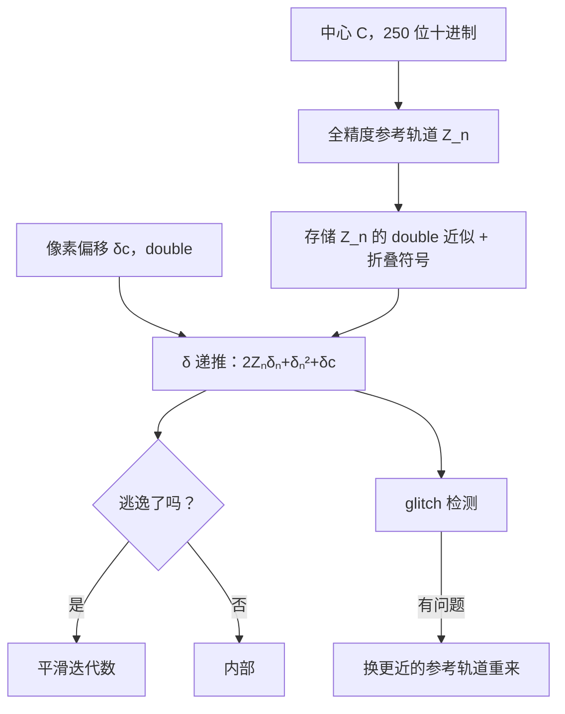

# 这些分形背后的数学原理

*一份写给 `src/` 与 `src/mathx/` 深缩放引擎的完整教程。*
*读完你会明白一张图为什么是对的，而不只是知道怎么点按钮。*

英文版：[`FRACTAL_MATH.md`](FRACTAL_MATH.md)

---

## 目录

0. [怎么读这本书](#0-怎么读这本书)
1. [从零开始的复数](#1-从零开始的复数)
2. [一个递推式，两张平面](#2-一个递推式两张平面)
3. [逃逸时间：把规则变成颜色](#3-逃逸时间把规则变成颜色)
4. [平滑着色：去掉年轮](#4-平滑着色去掉年轮)
5. [双精度为什么在 10¹⁶ 处失效](#5-双精度为什么在-1016-处失效)
6. [扰动法：让无限放大变便宜的核心技巧](#6-扰动法让无限放大变便宜的核心技巧)
7. [五个折叠族](#7-五个折叠族)
8. [用户公式与解析 jet](#8-用户公式与解析-jet)
9. [如何找到一个值得放大的点](#9-如何找到一个值得放大的点)
10. [精度体系](#10-精度体系)
11. [迭代预算与「大黑坨」](#11-迭代预算与大黑坨)
12. [可复现命令手册](#12-可复现命令手册)
13. [术语表](#13-术语表)

---

## 0. 怎么读这本书

程序只画一类东西：**轨道不逃逸的初始值集合的边界**。
程序里每一个特性——256 位坐标、参考轨道、jet、迭代计数——都是为了让同一个问题算得又对又快：

> 对这一个像素，轨道是否有界？如果逃逸了，*在第几步*逃逸？

章节按难度递增，从问题走到代码。每个公式都写出来，不跳步。

```
     复数运算 → 迭代 → 逃逸时间 → 平滑着色
                         ↓
              双精度在 1e16 处失效
                         ↓
        任意精度参考轨道 + 扰动法（double 像素环）
                         ↓
           折叠族 / 自定义公式 / 10^120
```

---

## 1. 从零开始的复数

复数就是一对实数：

$$
z = x + iy, \qquad i^2 = -1
$$

`x` 叫**实部**（`Re z`），`y` 叫**虚部**（`Im z`）。把它当成复平面上的点 `(x, y)`。

**加法**按分量做：

$$
(x+iy)+(u+iv) = (x+u) + i(y+v)
$$

**乘法**用 $i^2=-1$：

$$
(x+iy)(u+iv) = (xu-yv) + i(xv+yu)
$$

举例：$(1+2i)(3-i) = (3+2) + i(-1+6) = 5+5i$。

**模长**（到原点的距离）：

$$
|z| = \sqrt{x^2+y^2}
$$

**共轭**（关于实轴镜像）：

$$
\bar z = x - iy
$$

着色器和 jet 都会用到的恒等式：

| 恒等式 | 含义 |
| --- | --- |
| $z\bar z = x^2+y^2 = \lvert z\rvert^2$ | 复数乘共轭得到实数 |
| $\operatorname{Re}z = (z+\bar z)/2$ | 取实部 |
| $\operatorname{Im}z = (z-\bar z)/(2i)$ | 取虚部 |
| $\overline{z^2} = \bar z^{\,2}$ | 共轭与平方可交换 |
| $|uv| = |u|\,|v|$ | 模长可乘 |

**平方**是曼德勃罗集重复几百万次的操作：

$$
z^2 = (x+iy)^2 = (x^2-y^2) + i(2xy)
$$

程序给两块起专门的名字，因为每个分形族都会再遇到它们：

$$
A = x^2-y^2, \qquad B = 2xy, \qquad z^2 = A + iB
$$

第七章的关键观察：**五个内建族全都是对 `A`、`B` 改符号或取绝对值**。所以它们能共用一套精确扰动引擎。

---

## 2. 一个递推式，两张平面

取函数 $f$，反复作用：

$$
z_0 \text{ 给定}, \qquad z_{n+1} = f(z_n, c)
$$

二次映射 $f(z,c)=z^2+c$ 即

$$
z_{n+1} = z_n^2 + c, \qquad z_0 = 0 \text{（曼德勃罗）或 } z_0 \text{ 任意（朱丽叶）}
$$

同一个公式有**两种看法**。混用它们是「图怎么不对」最常见的来源。

| | 曼德勃罗集 **M** | 朱丽叶集 **J_c** |
| --- | --- | --- |
| 变化的是 | 参数 $c$ | 起点 $z_0$ |
| 固定的是 | $z_0 = 0$ | $c$ |
| 你看到的平面 | **参数平面** | **动力平面** |
| 一个像素代表 | 「试这个 $c$」 | 「试这个 $z_0$」 |
| 定义 | $\{c : z_n(c) \text{ 有界}\}$ | $\{z_0 : z_n(z_0) \text{ 有界}\}$ |

严格写法：

$$
M = \{\,c\in\mathbb{C} : \sup_n |z_n| < \infty,\ z_0=0,\ z_{n+1}=z_n^2+c\,\}
$$

$$
K_c = \{\,z_0\in\mathbb{C} : \sup_n |z_n| < \infty\,\}, \qquad J_c = \partial K_c
$$

朱丽叶集 $J_c$ 是填充朱丽叶集的**边界**。$c\in M$ 时 $J_c$ 连通；$c\notin M$ 时它是康托尘。这两张图的根本联系就在这里。


**为什么一定要看边界？** 集合内部轨道都跑到同一个吸引子，外部逃逸速度也差不多。真正有变化的东西——细丝、螺旋、自相似——全在分隔曲线上。这也是深缩放必须对准边界点的原因：第九章专门生成 220 位边界坐标。

---

## 3. 逃逸时间：把规则变成颜色

对每个像素迭代，直到：

1. $|z_n| > R$（逃逸），或
2. $n = N$（预算耗尽）。

逃逸的像素拿到**逃逸时间** $n$；其余判为内部，画黑。

**为什么 $R=2$ 就够？** 设 $|c|\le 2$ 且 $|z_n|>2$：

$$
|z_{n+1}| = |z_n^2+c| \ge |z_n|^2 - |c| > |z_n|^2-2
$$

当 $|z_n|>2$ 时 $|z_n|^2-2 > |z_n|$，所以 $|z_{n+1}|>|z_n|$ 且至少平方增长，逃逸是必然的。（$|c|>2$ 时第一步就逃逸，判据完整。）

```text
n = 0        z0 = 0
n = 1        z1 = c                  |z1| <= 2 ? 继续
n = 2        z2 = c^2 + c
...
n = 800      z800                    |z| 始终没超过 2 -> 内部
```

迭代次数不只是颜色编号，它更像一个**距离坐标**：在边界附近逐像素剧烈变化，细丝因此可见。如果 $N$ 太小，所有像素都被截断在 $N$，整帧变黑——见第十一章。

**内部快速判据。** 曼德勃罗集有两块区域可以不迭代直接判定：

$$
\text{主心形：} q=\left(x-\tfrac14\right)^2+y^2,\qquad
q\left(q+\left(x-\tfrac14\right)\right)\le \tfrac14 y^2
$$

$$
\text{周期 2 圆盘：} (x+1)^2+y^2\le \tfrac1{16}
$$

程序还会检测周期轨道：把 $z_n$ 与历史值比较，命中周期 $p$ 即永不逃逸。

---

## 4. 平滑着色：去掉年轮

整数逃逸时间会产生可见的等高环。利用逃逸后 $z_{n+1}\approx z_n^2$、即 $\log|z_n|$ 每步翻倍，可以插值：

$$
\nu = n + 1 - \log_2\!\left(\frac{\ln |z_n|}{\ln 2}\right)
$$

**四行推导。** 逃逸附近写 $|z_n| \approx R^{2^{\,n-s}}$，$s$ 是实数「逃逸时刻」。两边取两次对数：

$$
\ln|z_n| \approx 2^{\,n-s}\ln R
\;\Longrightarrow\;
\log_2\frac{\ln|z_n|}{\ln R} \approx n-s
\;\Longrightarrow\;
s \approx n-\log_2\frac{\ln|z_n|}{\ln R}
$$

取 $R=2$ 并调整索引就得到上式。$\nu$ 在像素之间连续变化，色带因此平滑。程序把**平滑场**（每像素一个 float）存下来，换调色板时只重新上色，不重新迭代——所以拖颜色滑块是瞬时的。

颜色级依次做：饱和 → 对比 → 伽马（$c^{1/\gamma}$）→ 增益 → 亮度。色表的频率与相位作用在**对数迭代域**，不是 RGB 空间。

---

## 5. 双精度为什么在 10¹⁶ 处失效

IEEE-754 double 有 53 位有效位 ≈ 15.95 位十进制数字。视口宽 $W$、放大倍数 $10^d$ 时，每像素对应的平面距离约为

$$
p \approx \frac{3}{W\,10^d}
$$

要区分相邻像素，中心坐标至少要有

$$
\text{位数} \gtrsim d + \log_{10} W + \text{保护位}
$$

位十进制数字。举例（1000 像素宽）：

| 放大 | 需要的十进制位数 |
| --- | --- |
| $10^{7}$ | ≈ 11 |
| $10^{16}$ | ≈ 20（double 已不够） |
| $10^{26}$ | ≈ 30 |
| $10^{120}$ | ≈ 124 |

所以程序取 `digits = 缩放深度 + 50`（对齐到机器 limb），HUD 报成 `bits ≈ digits × 3.321928`。截图里的 `CORE · julia · 256 bit` 约等于 77 位十进制数字，对 $10^{26}$ 绰绰有余。

**两个量不能混淆：**

- **坐标精度**——中心/像素偏移保留多少位（第 5、10 章）；
- **迭代预算**——轨道最多跑多少步（第 11 章）。

黑帧可能由任一原因造成。HUD 能区分：`参考轨道` 与 `逃逸` 是迭代证据，`bit` 是坐标证据。

---

## 6. 扰动法：让无限放大变便宜的核心技巧

逐像素做全精度运算是不可行的（150 万像素 × 2 万步 × 250 位乘法）。扰动法只算**一条**全精度轨道，其余几百万条用 double 围绕它算。

把每个像素写成参考点 $C$ 的小偏移：

$$
c = C + \delta c, \qquad z_n = Z_n + \delta_n
$$

参考轨道全精度计算：

$$
Z_0 \text{ 给定},\qquad Z_{n+1} = Z_n^2 + C
$$

两式相减：

$$
\begin{aligned}
z_{n+1} &= (Z_n+\delta_n)^2 + (C+\delta c)
        = Z_n^2 + C + 2Z_n\delta_n + \delta_n^2 + \delta c \\
\delta_{n+1} &= 2Z_n\delta_n + \delta_n^2 + \delta c
\end{aligned}
$$

大项 $Z_n^2+C$ 抵消了。剩下的全部可以用 double：$Z_n$ 取 double 近似，$\delta_n$ 是小 double，$\delta c$ 是像素偏移。**朱丽叶**模式下参数固定，$\delta c=0$，只剩初始偏移：

$$
\delta_0 = z_0-Z_0,\qquad \delta_{n+1}=2Z_n\delta_n+\delta_n^2
$$



### 6.1 glitch 与 rebase

当 $Z_n+\delta_n$ 远小于其中任一项时，抵消掉有效位，近似失效。核心用的判据是

$$
|Z_n+\delta_n| \ll \max(|Z_n|,|\delta_n|)
$$

（实现用平方比较，阈值约丢 20 位）。命中后像素 **rebase**：选一条更靠近它的参考轨道，从那一步重新开始。程序准备多条参考梯，保留活得最久的那条。

### 6.2 级数近似

$\delta_n$ 还很小时，前几步几乎线性，可以整块跳过：

$$
\delta_n \approx A_n\,\delta c + B_n\,(\delta c)^2
$$

系数随参考轨道一起传播，一次跳过 64 步。当像素尺度低于 $2^{-32}$ 时程序关闭它——线性模型曾在整帧画出平滑的暗弧。

### 6.3 参考必须比像素活得久

参考轨道若在第 $k$ 步逃逸，则 $n>k$ 没有 $Z_n$。所以核心一次性把**完整迭代预算**给参考轨道（`ref_cap = maxiter`），绝不给 8192 的前缀。参考被截断会把整帧判成内部——这是另一个经典的「黑块」bug。

---

## 7. 五个折叠族

五个映射都是「平方，然后对某些分量折叠」，再加 $c$。用 $A=x^2-y^2$、$B=2xy$：

| 族 | 映射 $F(x+iy)$ | 折叠后的 $(A',B')$ |
| --- | --- | --- |
| 曼德勃罗 | $(x+iy)^2+c$ | $(A,\,B)$ |
| 三叉戟（共轭） | $\overline{(x+iy)}^{\,2}+c$ | $(A,\,-B)$ |
| 燃烧船 | $(\lvert x\rvert+i\lvert y\rvert)^2+c$ | $(A,\,2\lvert xy\rvert)$ |
| 凯尔特 | $\lvert x^2-y^2\rvert+i\,2xy+c$ | $(\lvert A\rvert,\,B)$ |
| 垂直 | $x^2-y^2+i\lvert 2xy\rvert+c$ | $(A,\,\lvert B\rvert)$ |
| 凤凰 | $z^2+p\,z_{n-1}+c$ | $(A+p\,\Re z_{n-1},\,B+p\,\Im z_{n-1})$ |

**为什么可以完全精确？** 折叠只是符号或绝对值；参考轨道告诉我们它在哪个分支，扰动就仍是多项式：

$$
\delta_{n+1} = F(Z_n+\delta_n,c+\delta c)-F(Z_n,C)
$$

例如三叉戟：

$$
\delta_{n+1}=2\overline{Z_n}\,\overline{\delta_n}+\overline{\delta_n}^{\,2}+\delta c
$$

燃烧船在参考与像素的 $x,y$ 符号一致时：

$$
\delta_{n+1}=2\,|X_n|\,\delta X + 2\,|Y_n|\,\delta Y + \delta X^2-\delta Y^2
  \;+\; i\bigl(2\,\mathrm{sgn}(X_nY_n)(X_n\delta Y+Y_n\delta X)+2\delta X\delta Y+\delta c_y\bigr)
$$

符号**取自参考轨道**——这就是全部技巧。没有丢掉任何 Taylor 余项，所以 $10^{120}$ 与 $10^{2}$ 一样精确。实测递推对直接求值的最坏相对误差 $6.2\times10^{-16}$（double 精度极限）。

**凤凰有记忆**：递推需要 $z_{n-1}$。扰动必须直接保存 $\delta_{n-1}$；想从巨大的 $Z_{n-1}$ 反推会把小量吃掉。这个 bug 曾让整帧偏移六个迭代。

**实轴事实**：$c$、$z$ 都是实数时，五个族都退化为 $z_{n+1}=z_n^2+c$。下面这个 220 位 Misiurewicz 点（前周期 3、周期 1）

```
-1.543689012692076361570855971801747986525203297650983935240804037831...
```

因此**同时**是四个折叠族的边界点——1e120 的 oracle 测试就是这样造出来的。

---

## 8. 用户公式与解析 jet

输入的公式如 `sin(z)^2 + c` 由 `src/mathx/expr.cpp` 解析：词法分析 → Pratt 语法分析 → 后缀虚拟机。支持 $z,c,n,z_1$、单字母参数、隐式乘法（`2z`、`3(z+1)`）、`sum`/`prod`、比较运算和一张大函数表。

### 8.1 Wirtinger 导数

非全纯函数（用 `conj`、`re`、`im`、`abs`、`arg`）没有单一的复导数。改用 **Wirtinger 算子**：

$$
\frac{\partial}{\partial z}=\frac12\left(\frac{\partial}{\partial x}-i\frac{\partial}{\partial y}\right),
\qquad
\frac{\partial}{\partial \bar z}=\frac12\left(\frac{\partial}{\partial x}+i\frac{\partial}{\partial y}\right)
$$

全纯函数满足 $F_{\bar z}=0$。解析器维护 `holomorphic` 标志，为真时跳过共轭三项——既快又精确。

### 8.2 jet

在每个参考点，引擎求值**一个对象**，内含函数值与二阶导数：

$$
\mathcal J F = \bigl(F,\;F_z,\;F_{\bar z},\;F_c,\;F_{zz},\;F_{z\bar z},\;F_{\bar z\bar z},\;F_{zc},\;F_{cc},\;F_{z_1}\bigr)
$$

二阶导数把 $1/2$ 折进去了（存的 `dzz` 是 $F_{zz}/2$）。种子是 $F_z[z]=1$、$F_c[c]=1$、$F_{z_1}[z_1]=1$；链式法则把整个元组推过每个运算符。这样每步只求值一次，取代原来的五次有限差分。

### 8.3 像素递推

记 $u=\delta z$、$\Delta c=\delta c$、$p$ 为像素尺度、$u_{-1}$ 为上一步偏移，一步是

$$
\begin{aligned}
u_{n+1} ={}& F_z\,u_n + F_{\bar z}\,\bar u_n + F_c\,\Delta c + F_{z_1}\,u_{n-1} \\
&+ p\Bigl(F_{zz}u_n^2 + F_{z\bar z}\,u_n\bar u_n + F_{\bar z\bar z}\bar u_n^2
             + F_{zc}\,u_n\Delta c + F_{cc}\,\Delta c^2\Bigr)
\end{aligned}
$$

（存了 $1/2$ 的项在需要处还原系数）。全纯映射不需要的项为零，不花时间。

例 1：$F(z,c)=z^2+c$：

$$
F_z=2Z,\quad F_c=1,\quad F_{zz}=2,\quad F_{\bar z}=F_{zc}=F_{cc}=0
$$

递推坍缩成 $u_{n+1}=2Z_nu_n+\Delta c+p\,u_n^2$，即经典扰动公式。

例 2：$F(z,c)=\sin(z)c+z^2$：

$$
F_z=c\cos Z+2Z,\quad F_c=\sin Z,\quad F_{zz}=-c\sin Z+2,\quad F_{zc}=\cos Z,\quad F_{cc}=0
$$

漏掉 $F_{zc}$ 会让大部分像素落到边界错误的一侧——这是逐像素 oracle 测试抓出来的，后来补上了交叉项。

### 8.4 参数精度

滑块数值若被截成 double 只剩 16 位，族的有效深度就卡在 $10^{16}$。所以 `--param a=...` 与 `--phoenix ...` 收**十进制字符串**，按轨道的工作精度解析成 `BigFloat`。$a=0.1+10^{-120}$ 的测试证明 120 位全部进入内核。

---

## 9. 如何找到一个值得放大的点

在 $10^{120}$ 处，几乎所有坐标都落在平坦区。你需要一个**边界上**的点，且位数相当。两个求解器负责这件事。

**原子域中心（核，周期 $p$）**：超吸引周期，$z_0=0$，故 $z_p(c)=0$，用复数 Newton 求解。

**Misiurewicz 点**（前周期 $m$、周期 $p$）：边界上的排斥前周期点，满足

$$
F(c) = z_{m+p}(c)-z_m(c)=0
$$

二元 Newton 需要雅可比

$$
J=\begin{pmatrix}
\partial F_r/\partial c_r & \partial F_r/\partial c_i\\
\partial F_i/\partial c_r & \partial F_i/\partial c_i
\end{pmatrix},
\qquad
\binom{c_r}{c_i}\leftarrow\binom{c_r}{c_i}-J^{-1}\binom{F_r}{F_i}
$$

中心差分必须对 **$F$ 本身**做。只对 $z_n$ 差分（忘了 $z_m$ 也随 $c$ 变）会让每步大约长 1.5 倍、变成线性收敛——这是打印残差后才发现的隐蔽 bug。

```bash
mset misiurewicz --m 2 --p 2 --digits 300        # c = i 精确
mset nucleus --center-re -0.743643887037151 \
             --center-im 0.13182590420533 --digits 120
mset family-point --kind tricorn --preperiod 3 --period 1 \
                  --digits 220 --guess-re -1.5437
```

最后一条命令生成了第七章引用的 220 位实轴点。

---

## 10. 精度体系

| 层 | 做什么 | 为什么 |
| --- | --- | --- |
| `BigFloat`（`bigfloat.cpp`） | 以 $10^9$ 为 limb 的任意长度定点数，自带加减乘 | 可移植、无外部依赖；十进制位数直接映射到 limb 数 |
| GMP 桥（`gmp_bridge.cpp`） | `dlopen("libgmp.so.10")` / `LoadLibrary`，用 mpf 算参考轨道 | 大数乘法快；缺 DLL 时回退到 `BigFloat` |
| `src/mathx/bigmath.cpp` | 同精度下的 `div`、`sqrt`、`exp`、`log`、`sin`、`cos`、`atan`、`pow`、$\pi$、$\ln 10$ | 任意公式与边界求解器需要 |
| `floatexp` | 尾数 + 二进制指数 | 让超出 double 的逃逸值仍可表示 |

工作宽度取 `digits = 缩放深度 + 50`，`precision_limbs = 按 64 对齐(digits / 9)`。**宿主必须在解析中心之前设置精度**：`from_string` 按线程局部位宽截断，残留的 90 位设置会悄悄把 180 位坐标切掉。

GMP 每步实测：6000 / 12000 / 24000 / 60000 / 120000 位分别是 22 / 43 / 106 / 463 / 980 µs——这个区间没有 FFT 阈值跳变，所以性能杠杆是**减少步数**，而不是换乘法算法。周期参考轨道（如 $c=i$）可解析平铺：$10^{60000}$ 一帧只要 0.65 s。

---

## 11. 迭代预算与「大黑坨」

这一章解释那张 bug 截图背后的机理。HUD 当时写的是：

```text
缩放 10^26.6   CORE · julia · 256 bit · 参考轨道 801 · 逃逸 780–800 · 完成 160 ms
缩放 10^26.7   CORE · julia · 256 bit · 参考轨道 961 · 逃逸 783–1146 · 完成 107 ms
```

两帧来自**同一个 C++ 核心、同一种精度**。差别只是迭代上限：

| | 第一帧 | 第二帧 |
| --- | --- | --- |
| 预算 | 800 | 约 1200 |
| 最大逃逸 | 800（正好顶到上限） | 1146（有余量） |
| 画面 | 一大坨黑 | 完整细节 |

当观测到的最大逃逸等于预算，这一帧是**截断的**：本该更晚逃逸的像素被切掉并报成内部。引擎按三步反应：

1. `noteFrameObservation(cap, escMax, bounded, refLen)` 记录观测；
2. 深视点且大部分像素是内部、逃逸又全部停在上限时，该帧标记为 *suspect*，**不画出来**——画布保留上一张正确的帧；
3. 上限抬高一次（`observedIter.cap`，`maxRefine = 3`），`scheduleRender(140)` 用新预算重画。

「每视点只重画一次」这个限制很关键：混沌边界上*任何*有限上限总会有像素顶到，无限重试会把 0.25 秒的帧拖成 7 秒而画面毫无变化。

网页端与桌面端现在共用这条规则。修复前，网页端抬了上限却忘了第 3 步，黑帧就一直留在屏幕上直到用户再动一下——所以看起来像「一套低精度渲染器和一套正确渲染器轮流工作」。

---

## 12. 可复现命令手册

```bash
# 1. 完整曼德勃罗集，1200x800，4000 次迭代
mset render --center-re -0.6 --center-im 0 --zoom 1e0 \
            --width 1200 --height 800 --maxiter 4000 --out whole.png

# 2. 经典海马谷 1e12（中心 15 位）
mset render --center-re -0.743643887037151 --center-im 0.13182590420533 \
            --zoom 1e12 --width 1200 --height 800 --maxiter 4000 --out seahorse.png

# 3. c = i 是 Misiurewicz 点：任意深度、精确自相似
mset render --center-re 0 --center-im 1 --zoom 1e6000 --out ci.png

# 4. 折叠族 1e120（中心由 family-point 生成的 220 位坐标）
mset family --kind tricorn --center-re <220 位> --center-im 0 \
            --zoom 1e120 --width 800 --height 500 --maxiter 2500 --out tricorn.png

# 5. 自定义公式；参数保留全部位数
mset family --kind formula --expr "z^2 + a*z + c" \
            --param a=0.1000...0001 --zoom 1e60 --out formula.png

# 6. Oracle 测试（初等函数、jet、五族、1e60/1e120）
tests\expr.bat
tests\family.bat
```

读 HUD：

- `CORE / NATIVE` —— 像素由 C++ 内核产生；
- `julia / pert` —— 朱丽叶（固定 $c$、变 $z_0$）或曼德勃罗扰动（变 $c$）；
- `256 bit` —— 坐标精度，约 77 位十进制数字；
- `参考轨道 961` —— 参考轨道长度；远小于预算就要怀疑参考太短；
- `逃逸 783–1146` —— 观测到的最小/最大逃逸次数；上限等于预算表示「被截断」。

---

## 13. 术语表

| 术语 | 含义 |
| --- | --- |
| 轨道 | 序列 $z_0,z_1,z_2,\dots$ |
| 填充集 | 轨道有界的点集 |
| 朱丽叶集 | 固定 $c$ 时填充集的边界 |
| 曼德勃罗集 | 使 0 的轨道有界的参数 $c$ 的集合 |
| 逃逸时间 | 首个满足 $|z_n|>2$ 的 $n$ |
| 平滑迭代数 | 供着色用的连续版 $n$ |
| 扰动 | 把像素写成参考轨道的小偏移来计算 |
| 参考轨道 | 一帧共享的一条全精度轨道 |
| glitch | 抵消效应破坏扰动近似的像素 |
| rebase | 从更近的参考轨道重启 glitch 像素 |
| 级数近似 | 用 $\delta c$ 的多项式跳过前几步 |
| 折叠 | 非全纯族里的符号变化或绝对值 |
| jet | 函数值加若干阶导数 |
| Wirtinger 导数 | 把 $z$、$\bar z$ 当作独立变量求导 |
| 核（原子域中心） | 临界轨道周期的参数，$z_p(c)=0$ |
| Misiurewicz 点 | 满足 $z_{m+p}(c)=z_m(c)$ 的边界参数 |
| limb | 大整数的定宽块，这里是 $10^9$ |
| 像素尺度 | 每像素对应的平面距离 $p$ |
| 截断 | 最大逃逸次数等于迭代预算的帧 |

---

## 附录 A：例题与逐步演算

正文给出规则，这里用小数字把它们逐题算一遍。每道题都能用计算器核对。

### 例题 A1 —— 手算复数平方

**题目。** 计算 $(1+2i)^2$。

**第 1 步** —— 取 $x=1$，$y=2$。

**第 2 步** —— 代入 $A=x^2-y^2$：

$$A = 1^2-2^2 = 1-4 = -3$$

**第 3 步** —— 代入 $B=2xy$：

$$B = 2\cdot1\cdot2 = 4$$

**答案。** $(1+2i)^2 = -3+4i$。

**用 FOIL 验算**（首、外、内、末）：

$$(1+2i)(1+2i)=1+2i+2i+4i^2=1+4i-4=-3+4i\quad\checkmark$$

这正是像素核的第一行：`A = x*x - y*y`，`B = 2*x*y`。

---

### 例题 A2 —— 永不逃逸的轨道：$c=-1$

取 $z_0=0$，迭代 $z_{n+1}=z_n^2-1$。

| $n$ | 计算 | $z_n$ | $\lvert z_n\rvert$ |
| --- | --- | --- | --- |
| 0 | 给定 | $0$ | 0 |
| 1 | $0^2-1$ | $-1$ | 1 |
| 2 | $(-1)^2-1$ | $0$ | 0 |
| 3 | $0^2-1$ | $-1$ | 1 |

轨道永远在 $0,-1,0,-1,\dots$ 之间交替，模长始终不超过 2，所以该像素是**内部**。周期为 $p=2$；程序比较 $z_2$ 与 $z_0$ 就能提前停机。

---

### 例题 A3 —— 会逃逸的轨道与平滑值：$c=1$

| $n$ | 计算 | $z_n$ | $\lvert z_n\rvert^2$ |
| --- | --- | --- | --- |
| 0 | 给定 | $0$ | 0 |
| 1 | $0^2+1$ | $1$ | 1 |
| 2 | $1^2+1$ | $2$ | 4 |
| 3 | $2^2+1$ | $5$ | 25 |

判据是严格的（$|z|>2$，即 $|z|^2>4$）。$n=2$ 时刚好等于 4，**还不算逃逸**；$n=3$ 时 $25>4$，整数逃逸时间为 $n=3$。

平滑值（$R=2$）：

$$\nu = 3+1-\log_2\!\frac{\ln 5}{\ln 2}
     = 4-\log_2(2.3219)
     = 4-1.2153 = 2.7847$$

一个恰好在第 3 步、$|z_3|$ 刚超过 2 的像素会得到 $\nu\approx3.0$；本题超出很多，所以 $\nu<3$，颜色在色带上更靠前。这个连续偏移量就是年轮消失的原因。

---

### 例题 A4 —— 10^26 视点需要多少位？

**已知。** 视口 $W=1920$ 像素，放大 $10^{26}$。

**第 1 步** —— 像素尺度：

$$p=\frac{3}{1920\cdot10^{26}}=1.5625\times10^{-29}$$

**第 2 步** —— double 只有约 16 位十进制有效数字。中心量级为 1 时绝对舍入误差约 $10^{-16}$。与像素比较：

$$\frac{10^{-16}}{1.56\times10^{-29}}\approx6.4\times10^{12}$$

也就是 double 无法区分相邻像素，差了**十二个数量级**。所以画面是平的，不是迭代算错。

**第 3 步** —— 需要的位数（含 6 位保护）：

$$d+\log_{10}W+6 = 26+3.283+6 \approx 35.3 \Rightarrow 36\text{ 位}$$

**第 4 步** —— 程序实际用 $26+50=76$ 位 $\approx252$ bit，所以 HUD 显示 `256 bit`。余量用于覆盖轨道上的误差增长。

---

### 例题 A5 —— 一步扰动法的数值演算

取参考参数 $C=0.25$，参考轨道 $Z_0=0$、$Z_1=0.25$、$Z_2=0.3125$。某像素 $c=C+\delta c$，$\delta c=10^{-10}$。

**参考轨道：** $Z_{n+1}=Z_n^2+C$。

**像素（直接算）：** $z_0=0$，$z_1=0.2500000001$，

$$z_2=z_1^2+c=(0.2500000001)^2+0.2500000001=0.31250000015$$

**扰动法：** $\delta_0=0$，$\delta_1=\delta c=10^{-10}$，于是

$$\delta_2=2Z_1\delta_1+\delta_1^2+\delta c
=2(0.25)(10^{-10})+10^{-20}+10^{-10}=1.5\times10^{-10}+10^{-20}$$

**对照：** $z_2-Z_2=0.31250000015-0.3125=1.5\times10^{-10}$（$10^{-20}$ 项在打印精度以下），两者一致。

**省下了什么？** 像素没有做任何 76 位乘法，只做了 double 的 $Z_1\times\delta_1$。这就是 1e120 能算得动的原因。

---

### 例题 A6 —— 三叉戟的 δ 递推是精确的

设 $Z=0.5+0.2i$，$\delta=0.01-0.01i$，三叉戟映射 $F(z)=\bar z^{\,2}$。

**第 1 步** —— 取共轭：

$$\bar Z=0.5-0.2i,\qquad \bar\delta=0.01+0.01i$$

**第 2 步** —— 线性项 $2\bar Z\bar\delta$：

$$(0.5-0.2i)(0.01+0.01i)=0.005+0.005i-0.002i+0.002=0.007+0.003i$$

乘 2 得 $0.014+0.006i$。

**第 3 步** —— 二次项：

$$\bar\delta^{\,2}=(0.01+0.01i)^2=0.0001+0.0002i-0.0001=0.0002i$$

**第 4 步** —— 相加：

$$F(Z+\delta)-F(Z)=0.014+0.0062i$$

没有余项：映射是 $(z,\bar z)$ 的多项式，这两项就是**全部**项。用 Taylor 截断在这里反而是近似；核心里写的是精确式。

---

### 例题 A7 —— 数值代入 $\sin(z)c+z^2$ 的 jet

取 $Z=0.5$，$c=1$，$u=10^{-6}$，$\Delta c=2\times10^{-6}$，$p=1$。

**第 1 步** —— 按第 8 章的表求导：

$$F_z=c\cos Z+2Z=0.877583+1=1.877583$$
$$F_c=\sin Z=0.479426$$
$$F_{zz}=-c\sin Z+2=1.520574,\qquad F_{zc}=\cos Z=0.877583$$

**第 2 步** —— 一阶贡献：

$$F_zu=1.877583\times10^{-6},\qquad F_c\Delta c=0.958851\times10^{-6}$$

**第 3 步** —— 二阶贡献：

$$F_{zz}u^2=1.52\times10^{-12},\qquad F_{zc}u\Delta c=1.755\times10^{-12}$$

**第 4 步** —— 相加：

$$u'\approx2.836434\times10^{-6}$$

这里二阶项只有一阶项的百万分之一，但在 1e30 视点下像素尺度极小，二阶项会占主导；漏掉 $F_{zc}$ 曾是真 bug。

---

### 例题 A8 —— Newton 求 Misiurewicz 点：$m=2,p=2$

命题：$c=i$ 是 $F(c)=z_4(c)-z_2(c)$ 的根。

**第 1 步** —— 精确迭代：

$$z_0=0,\quad z_1=i,\quad z_2=i^2+i=-1+i$$
$$z_3=(-1+i)^2+i=(1-2i-1)+i=-i,\quad z_4=(-i)^2+i=-1+i$$

**第 2 步** —— 残差：

$$F(i)=z_4-z_2=(-1+i)-(-1+i)=0$$

精确为零，不需要 Newton 迭代。轨道从 $z_2$ 起以周期 2 重复，所以前 64 步之后可以按周期平铺——这就是 $10^{60000}$ 只用 0.65 s 的原因。

**第 3 步** —— 为什么要 220 位：在 $10^{120}$ 处放大，需要约 124 位正确的 $c$。求解器输出 220 位，因此该深度下最后一个像素的坐标仍然明确。

---

### 例题 A9 —— 从 HUD 判断「被截断的帧」

同一视点的两帧报告：

```text
CORE · julia · 256 bit · ref 801 · esc 780-800
CORE · julia · 256 bit · ref 961 · esc 783-1146
```

**第 1 步** —— 比较逃逸上限与预算。第一帧上限 800 正好等于预算 800：像素被截断。第二帧上限 1146、预算约 1200：有余量。

**第 2 步** —— 检查精度。两帧都是 256 bit，所以坐标精度不是原因。

**第 3 步** —— 结论：两张图来自**同一引擎**，只是第一帧的迭代上限更低。修复会在展示截断帧之前先抬高上限并重画，所以你现在看到的是一张正确的帧，而不是「黑帧 → 正确帧」。

---

### 例题 A10 —— 为什么不能对着核放大

取 $c=0$，周期 1 双曲分支的中心。此时 $z_0=0$，对所有 $n$ 都有 $z_{n+1}=0^2+0=0$：附近每个像素都有界，整帧内部黑。这在数学上完全正确，不是渲染 bug。

想在 $10^{120}$ 看到结构，必须把中心放到该分支的**边界**（如 $c=i$ 这样的 Misiurewicz 点），或放到核附近某个小曼德勃罗集的边界。`mset nucleus` 与 `mset family-point` 就是用来生成这类任意精度边界坐标的。
